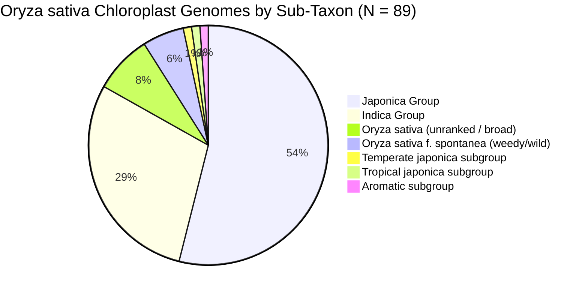

# NCBI Database Search & Curation Report: Complete Chloroplast Genomes of *Oryza sativa*

**Project:** Global Rice Population Genomics (`global-rice-popgen`)  
**Database:** NCBI Nucleotide (Entrez E-utilities)  
**Target Taxon:** Strictly *Oryza sativa* (NCBI TaxID: `4530` and recognized sub-taxa)  
**Target Sequence:** Chloroplast complete genome (~134.4 kb – 134.8 kb)  
**Generated Artifacts:** 
- TSV: [`results/tables/ncbi_oryza_sativa_chloroplast_genomes.tsv`](file:///d:/Magister/Proyek/global-rice-popgen/results/tables/ncbi_oryza_sativa_chloroplast_genomes.tsv)
- CSV: [`results/tables/ncbi_oryza_sativa_chloroplast_genomes.csv`](file:///d:/Magister/Proyek/global-rice-popgen/results/tables/ncbi_oryza_sativa_chloroplast_genomes.csv)
- Reproducible CLI Script: [`scripts/search_ncbi_chloroplast.py`](file:///d:/Magister/Proyek/global-rice-popgen/scripts/search_ncbi_chloroplast.py)

---

## 1. Executive Summary & Query Architecture

A rigorous search of the NCBI Nucleotide database was conducted using Biopython Entrez API wrappers linked to Python 3.11 inside `.venv`. In genomics databases, naively querying text strings introduces false positives (non-target species citing the query organism) or false negatives (taxonomic sub-group annotations).

```
                      NCBI Search Dissection
                      -----------------------
Total Nucleotide Text Hits: 94
  ├── Non-Oryza sativa contaminants: 7 (Saccharum spp., Oryza nivara / meyeriana)
  └── Strictly Oryza sativa Taxon: 87 records
        ├── Strict Title Match ("chloroplast complete genome"): 87
        ├── Title Phrasing Variant ("chloroplast DNA, complete genome"): +2 (LC739565, AP006728)
        └── Total Curated Rice Plastomes: 89 accessions (84 cultivated, 5 weedy/spontanea)
```

### Query Comparison & Database Dissection

| Search Scope | NCBI Query Syntax | Total Hits | Target Status | Remarks |
| :--- | :--- | :---: | :--- | :--- |
| **Unconstrained Text** | `Oryza sativa "chloroplast complete genome"` | **94** | Contaminated | Includes 4 *Saccharum* (sugarcane) genomes, 2 *Oryza nivara*, and 1 *Oryza meyeriana* where *O. sativa* was cited in reference publications. |
| **Strict Taxonomic Lineage** | `"Oryza sativa"[Organism] AND "chloroplast complete genome"` | **87** | **Strict Target** | Directly matches *Oryza sativa* (taxid:4530) and its varietal groups (*indica*, *japonica*, *spontanea*). |
| **Strict + Title Syntax Union** | `("Oryza sativa"[Organism]) AND (chloroplast[Title] AND "complete genome"[Title])` | **89** | **Complete Set** | Adds accession [LC739565.1](file:///d:/Magister/Proyek/global-rice-popgen/results/tables/ncbi_oryza_sativa_chloroplast_genomes.tsv#L89) (*Taichung 65*, titled "chloroplast DNA, complete genome") and historical [AP006728.1](file:///d:/Magister/Proyek/global-rice-popgen/results/tables/ncbi_oryza_sativa_chloroplast_genomes.tsv#L90). |
| **Unranked Taxon Only** | `"Oryza sativa"[Organism:noexp] AND "chloroplast complete genome"` | **7** | Truncated | Omits records annotated specifically under *Japonica Group* (`taxid:39947`) or *Indica Group* (`taxid:39946`). |
| **Plastid Synonyms** | `"Oryza sativa"[Organism] AND "plastid complete genome"` | **3** | Relevant Variants | Includes the classic RefSeq standard `NC_001320.1` (*Nipponbare*) and hybrid lines `PZ137540` (*Mestizo 1*) & `PZ137542` (*Maintainer B Line*). |

---

## 2. Taxonomic Sub-Group Distribution

Within the 89 complete chloroplast genomes strictly belonging to *Oryza sativa*, the sub-taxonomic classifications reflect the major cultivar groups:



- **Japonica Group (`taxid:39947`):** 48 accessions (53.9%)
- **Indica Group (`taxid:39946`):** 26 accessions (29.2%)
- **Oryza sativa (species level, `taxid:4530`):** 7 accessions (7.9%)
- **Oryza sativa f. spontanea (`taxid:63629`):** 5 accessions (5.6%)
- **Subgroup-specific annotations:** 3 accessions (Temperate japonica, Tropical japonica, Aromatic basmati)

---

## 3. Geographic & National Origin Analysis

Rice chloroplast genomes originate from distinct geographic regions reflecting both historical breeding programs and recent large-scale plastome sequencing initiatives.

### National Origin of Sequenced Germplasm

Two geographic dimensions were curated:
1. **GenBank Recorded Location (`/country` or `/geo_loc_name`):** Formal metadata provided by the submitter at deposit.
2. **Cultivar/Germplasm Origin Nation:** The historical nation of origin where the landrace evolved or where the modern cultivar was bred.

| Nation of Germplasm Origin | Count | Major Cultivars / Accessions Represented |
| :--- | :---: | :--- |
| **Russia** | **56** | Krasnodar Federal Scientific Rice Centre collection (*Rubin, Viola, Elbrus, Zlata, Oceano, Favorite, Avangard, Veles, Atlant, Khazar, Yakhont, Cammeo, Kurazh, Flagman, Lider*, etc.) |
| **China** | **14** | Landmark indica & japonica lines (*93-11, PA64S, Zhenshan 97, Minghui 63, Shuhui498, SR86, Jingeng 818*) |
| **Japan** | **6** | Temperate japonica standards (*Nipponbare, Yukara, Taichung 65*) |
| **South Korea** | **2** | *Milyang 23* (indica/japonica high-yielding cultivar), *temperate japonica* line |
| **India** | **2** | *N22* (Nagina-22 aus-type drought reference), *RP Bio-226* (improved Samba Mahsuri) |
| **Taiwan** | **2** | *TN1* (Taichung Native 1 semi-dwarf indica milestone), *Taichung 65* |
| **Philippines (IRRI)** | **2** | *IR8* (the "Miracle Rice" of the Green Revolution) |
| **Saudi Arabia** | **2** | *Hassawi* (salt/heat-adapted oasis landrace) and *Hassawi hybrid* |
| **Thailand** | **1** | *Pin Gaew 56* (traditional deepwater floating rice) |
| **Pakistan / India** | **1** | *Basmati* (aromatic varietal group) |
| **Unspecified / Wild** | **1** | Wild relative reference *W0038* |

---

## 4. Key Rice Cultivars & Germplasm Categories

### A. The Landmark Agronomic & Genomic Cultivars

These accessions represent foundational benchmarks in rice genetics and population history:

1. **Nipponbare** (Accessions: `AY522330.1`, `GU592207.1`, `KM088016.1`; RefSeq: `NC_001320.1`):
   - **Type:** Temperate *japonica*
   - **Origin:** Japan
   - **Genome Size:** 134,551 bp
   - **Significance:** The international reference genome standard for *Oryza sativa*.
2. **93-11** (Accessions: `AY522329.1`, `NC_008155.1`):
   - **Type:** Elite *indica*
   - **Origin:** Jiangsu, China
   - **Genome Size:** 134,496 bp
   - **Significance:** The primary reference assembly for the *indica* subspecies.
3. **PA64S (Peiai 64S)** (Accession: `AY522331.1`):
   - **Type:** Dual-purpose photoperiod/thermo-sensitive genic male sterile (PTGMS) line
   - **Origin:** Hunan, China (developed by Yuan Longping team)
   - **Genome Size:** 134,551 bp
   - **Significance:** Maternal parent of leading two-line hybrid rice varieties (e.g., Liangyoupeijiu). Notably carries a *japonica*-type plastome despite largely *indica* nuclear background.
4. **TN1 (Taichung Native 1)** (Accessions: `KM103369.1`, `NC_031333.1`):
   - **Type:** Semi-dwarf *indica* (carrying the *sd1* green revolution allele)
   - **Origin:** Taiwan
   - **Genome Size:** 134,502 bp
5. **IR8** (Accessions: `KM103368.1`, `KM103367.1`):
   - **Type:** High-yielding semi-dwarf *indica*
   - **Origin:** Philippines (IRRI)
   - **Genome Size:** 134,502 bp
   - **Significance:** The "Miracle Rice" that catalyzed the Asian Green Revolution in the 1960s.
6. **N22 (Nagina-22)** (Accession: `MG252500.1`):
   - **Type:** *aus* group landrace
   - **Origin:** Uttar Pradesh, India (Voucher: `IRRI:IRIS 179-1440867`)
   - **Genome Size:** 134,503 bp
   - **Significance:** The global reference for extreme heat and drought tolerance in rice.
7. **Zhenshan 97 & Minghui 63** (Accessions: `CP056064.1`, `CP054688.1`):
   - **Type:** *indica* cytoplasmic male sterile maintainer line & restorer line
   - **Origin:** Wuhan, China
   - **Genome Size:** 134,501 bp / 134,506 bp
   - **Significance:** The two parental lines of *Shanyou 63*, China's most widely grown three-line hybrid rice for over two decades.
8. **SR86 (Sea Rice 86)** (Accession: `MZ424305.1`):
   - **Type:** Saline-alkali tolerant wild-derived cultivar
   - **Origin:** Guangdong/Shenzhen, China
   - **Genome Size:** 134,496 bp

### B. The Northern European Edge Collection (Krasnodar, Russia)

A substantial cohort (56 of 89 accessions, `PX059446.1` to `PX059501.1`) originates from a recent plastome diversity study conducted at the **Federal Scientific Rice Centre** in Krasnodar, Russia (submitted 2025/2026, titled *"Diversity of Oryza sativa plastomes on the European northern edge of planting area"*).

- **Named Russian Cultivars:** *Saw-An-T, Rubin, Tai Bonnet, Viola, Elbrus, Zlata, Oceano, Favorite, Dular, Arroz Buit, Ruille, Avangard, ZHONG FV 906, Mars, Azerbajdzhanskij, Fielote, Veles, Don 7113, Aral 7, Atlant, Khaw-sri-nin, Kaz NIIR-5, Novoselskij, Khazar, Yakhont, Cammeo, Chernye glaza, Kurazh, CRLB 1, Krasnozernaya forma 7, Kenddao 8, Azovskij, Snezhinka, Patriot, Lider, Flagman, Romans, Svetlana, Mavr, Yuzhnaya noch, Gagat*.
- **Specialized Breeding & Resistance Lines:**
  - `PX059471.1`: Line `IRBL T-K59` (IRRI monogenic blast resistance differential carrying the *Pik-m* resistance allele).
  - `PX059454.1`: Line `IRBLta-CP1` (IRRI blast differential carrying the *Pita* resistance allele).
  - `PX059475.1`: Line `AA 13886/12 PSB Rc 10` (IRRI/PhilRice Philippine cultivar *Pagsanjan*).
  - Dihaploid lines: *Heibar lo/60*, *lo/76-270/4*, *lo-2327-10*, *lk/1-d10*.

---

## 5. Comprehensive Summary Table of All 89 Accessions

The full curated dataset is archived in [`results/tables/ncbi_oryza_sativa_chloroplast_genomes.tsv`](file:///d:/Magister/Proyek/global-rice-popgen/results/tables/ncbi_oryza_sativa_chloroplast_genomes.tsv). Below is the comprehensive table of all records:

| # | Accession | Sub-Taxon Organism | Cultivar Name | Isolate / Voucher | Nation of Origin | Sequence Length (bp) |
| :-: | :--- | :--- | :--- | :--- | :--- | :-: |
| 1 | `PX059501.1` | Japonica Group | **Saw-An-T** | `s-jd5ectj` | Russia | 134,551 |
| 2 | `PX059500.1` | Japonica Group | **Rubin** | `r-jd5ectj` | Russia | 134,534 |
| 3 | `PX059499.1` | Indica Group | **Tai Bonnet** | `t-jd5ectj` | Russia | 134,556 |
| 4 | `PX059498.1` | Japonica Group | **Viola** | `u-jd5ectj` | Russia | 134,551 |
| 5 | `PX059497.1` | Japonica Group | **Line ##04466** | `v-jd5ectj` | Russia | 134,562 |
| 6 | `PX059496.1` | Japonica Group | **Elbrus** | `w-jd5ectj` | Russia | 134,534 |
| 7 | `PX059495.1` | Indica Group | **Zlata** | `x-jd5ectj` | Russia | 134,534 |
| 8 | `PX059494.1` | Indica Group | **Oceano** | `i-jd5ectj` | Russia | 134,534 |
| 9 | `PX059493.1` | Japonica Group | **Favorite** | `y-jd5ectj` | Russia | 134,534 |
| 10 | `PX059492.1` | Japonica Group | **Dular** | `10-jd5ectj` | Russia | 134,511 |
| 11 | `PX059491.1` | Indica Group | **Arroz Buit** | `z-jd5ectj` | Russia | 134,556 |
| 12 | `PX059490.1` | Indica Group | **Ruille** | `11-jd5ectj` | Russia | 134,551 |
| 13 | `PX059489.1` | Japonica Group | **Line PV-1 GR 75499-84** | `12-jd5ectj` | Russia | 134,556 |
| 14 | `PX059488.1` | Japonica Group | **Dihaploid Heibar lo/60** | `13-jd5ectj` | Russia | 134,551 |
| 15 | `PX059487.1` | Japonica Group | **Avangard** | `14-jd5ectj` | Russia | 134,534 |
| 16 | `PX059486.1` | Japonica Group | **ZHONG FV 906** | `15-jd5ectj` | Russia | 134,502 |
| 17 | `PX059485.1` | Indica Group | **Mars** | `j-jd5ectj` | Russia | 134,551 |
| 18 | `PX059484.1` | Japonica Group | **Azerbajdzhanskij** | `16-jd5ectj` | Russia | 134,536 |
| 19 | `PX059483.1` | Japonica Group | **Fielote** | `18-jd5ectj` | Russia | 134,534 |
| 20 | `PX059482.1` | Japonica Group | **Dihaploid lo/76-270/4** | `17-jd5ectj` | Russia | 134,551 |
| 21 | `PX059481.1` | Japonica Group | **Line VNIIR 9714** | `1b-jd5ectj` | Russia | 134,534 |
| 22 | `PX059480.1` | Japonica Group | **Veles** | `19-jd5ectj` | Russia | 134,551 |
| 23 | `PX059479.1` | Japonica Group | **Line VNIIR 10163** | `1a-jd5ectj` | Russia | 134,551 |
| 24 | `PX059478.1` | Indica Group | **Don 7113** | `1c-jd5ectj` | Russia | 134,534 |
| 25 | `PX059477.1` | Japonica Group | **Aral 7** | `1d-jd5ectj` | Russia | 134,551 |
| 26 | `PX059476.1` | Japonica Group | **Atlant** | `1e-jd5ectj` | Russia | 134,551 |
| 27 | `PX059475.1` | Japonica Group | **Line PSB Rc 10** | `1f-jd5ectj` | Russia | 134,557 |
| 28 | `PX059474.1` | Japonica Group | **Dihaploid lo-2327-10** | `1g-jd5ectj` | Russia | 134,551 |
| 29 | `PX059473.1` | Japonica Group | **Line VNIIR 6523** | `1h-jd5ectj` | Russia | 134,551 |
| 30 | `PX059472.1` | Indica Group | **Khaw-sri-nin** | `k-jd5ectj` | Russia | 134,556 |
| 31 | `PX059471.1` | Japonica Group | **Line IRBL T-K59 (Pik-m)** | `1i-jd5ectj` | Russia | 134,551 |
| 32 | `PX059470.1` | Japonica Group | **Kaz NIIR-5** | `1j-jd5ectj` | Russia | 134,551 |
| 33 | `PX059469.1` | Japonica Group | **Novoselskij** | `1k-jd5ectj` | Russia | 134,502 |
| 34 | `PX059468.1` | Japonica Group | **Khazar** | `1l-jd5ectj` | Russia | 134,534 |
| 35 | `PX059467.1` | Japonica Group | **Yakhont** | `1m-jd5ectj` | Russia | 134,533 |
| 36 | `PX059466.1` | Japonica Group | **Cammeo** | `1n-jd5ectj` | Russia | 134,551 |
| 37 | `PX059465.1` | Japonica Group | **Chernye glaza** | `l-jd5ectj` | Russia | 134,498 |
| 38 | `PX059464.1` | Japonica Group | **Dihaploid lk/1-d10** | `1o-jd5ectj` | Russia | 134,551 |
| 39 | `PX059463.1` | Japonica Group | **Kurazh** | `1s-jd5ectj` | Russia | 134,551 |
| 40 | `PX059462.1` | Japonica Group | **Line VNIIR 6189** | `1p-jd5ectj` | Russia | 134,534 |
| 41 | `PX059461.1` | Indica Group | **CRLB 1** | `1q-jd5ectj` | Russia | 134,556 |
| 42 | `PX059460.1` | Japonica Group | **Krasnozernaya forma 7** | `1r-jd5ectj` | Russia | 134,551 |
| 43 | `PX059459.1` | Indica Group | **Line IR 11 t261** | `1u-jd5ectj` | Russia | 134,502 |
| 44 | `PX059458.1` | Japonica Group | **Kenddao 8** | `1t-jd5ectj` | Russia | 134,551 |
| 45 | `PX059457.1` | Japonica Group | **Azovskij** | `1v-jd5ectj` | Russia | 134,556 |
| 46 | `PX059456.1` | Indica Group | **Snezhinka** | `1w-jd5ectj` | Russia | 134,534 |
| 47 | `PX059455.1` | Japonica Group | **Patriot** | `1x-jd5ectj` | Russia | 134,534 |
| 48 | `PX059454.1` | Japonica Group | **Line IRBLta-CP1 (Pita)** | `m-jd5ectj` | Russia | 134,551 |
| 49 | `PX059453.1` | Japonica Group | **Lider** | `1y-jd5ectj` | Russia | 134,551 |
| 50 | `PX059452.1` | Japonica Group | **Flagman** | `1z-jd5ectj` | Russia | 134,534 |
| 51 | `PX059451.1` | Japonica Group | **Romans** | `20-jd5ectj` | Russia | 134,551 |
| 52 | `PX059450.1` | Indica Group | **Svetlana** | `21-jd5ectj` | Russia | 134,534 |
| 53 | `PX059449.1` | Japonica Group | **Mavr** | `q-jd5ectj` | Russia | 134,534 |
| 54 | `PX059448.1` | Japonica Group | **Yuzhnaya noch** | `n-jd5ectj` | Russia | 134,556 |
| 55 | `PX059447.1` | Indica Group | **Gagat** | `o-jd5ectj` | Russia | 134,502 |
| 56 | `PX059446.1` | Indica Group | **Line AA 31223** | `p-jd5ectj` | Russia | 134,502 |
| 57 | `PX733955.1` | Oryza sativa | Unspecified accession | HAAS-2025 | China | 134,502 |
| 58 | `OP729774.2` | Indica Group | **Pin Gaew 56** | Floating landrace | Thailand | 134,569 |
| 59 | `NC_031333.1` | Oryza sativa | **TN1** | Taichung Native 1 | Taiwan | 134,502 |
| 60 | `NC_008155.1` | Indica Group | **93-11** | BGI-9311 | China | 134,496 |
| 61 | `NC_005973.1` | O. sativa f. spontanea | Wild relative (*O. nivara*) | `SL10` / `W0038` | Cambodia / Japan | 134,494 |
| 62 | `MT712789.1` | O. sativa f. spontanea | Wild form SCBG | SCBG-spontanea | China | 134,502 |
| 63 | `MZ424305.1` | Oryza sativa | **SR86** | Sea Rice 86 | China | 134,496 |
| 64 | `MW001303.1` | Temperate japonica | Unspecified | QUST-TJ | China | 134,556 |
| 65 | `CP056064.1` | Indica Group | **Zhenshan 97** | CMS Maintainer | China | 134,501 |
| 66 | `CP054688.1` | Indica Group | **Minghui 63** | Restorer line | China | 134,506 |
| 67 | `MT653617.1` | Oryza sativa | **HSAGSDYD1802** | Yellow mutant | China | 134,502 |
| 68 | `MK348618.1` | Oryza sativa | **Jingeng 818** | `Jingeng818` | China | 134,435 |
| 69 | `MG252500.1` | Oryza sativa | **N22 (Nagina-22)** | Voucher: `IRIS 179-1440867` | India | 134,503 |
| 70 | `CP018170.1` | Indica Group | **Shuhui498** | `Shuhui498` | China | 134,546 |
| 71 | `KF359901.1` | O. sativa f. spontanea | Wild relative (*O. nivara*) | KIB-wild | China | 134,785 |
| 72 | `AY522331.1` | Japonica Group | **PA64S** | `PA64S` | China | 134,551 |
| 73 | `AY522330.1` | Japonica Group | **Nipponbare** | Landmark reference | Japan | 134,551 |
| 74 | `AY522329.1` | Indica Group | **93-11** | Landmark reference | China | 134,496 |
| 75 | `GU592207.1` | Japonica Group | **Nipponbare** | Voucher: `AC01-1001045` | Japan | 134,551 |
| 76 | `KU705873.1` | Indica Group | **RP Bio-226** | CCMB elite line | India | 134,493 |
| 77 | `KT289404.1` | Tropical japonica | Tropical japonica | KUST-TrJ | China | 134,536 |
| 78 | `KT289403.1` | Aromatic subgroup | **basmati** | Basmati Varietal | Pakistan / India | 134,499 |
| 79 | `JN861110.1` | Indica Group | **Hassawi hybrid** | `IR1112 x Hassawi` | Saudi Arabia | 134,459 |
| 80 | `JN861109.1` | Indica Group | **Hassawi** | Oasis landrace | Saudi Arabia | 134,448 |
| 81 | `KM088017.1` | Japonica Group | **Yukara** | Hokkaido cultivar | Japan | 134,551 |
| 82 | `KM088016.1` | Japonica Group | **Nipponbare** | SNU assembly | Japan | 134,551 |
| 83 | `KM103382.1` | Indica Group | **Milyang 23** | Voucher: `WAB0028987` | South Korea | 134,551 |
| 84 | `KM103369.1` | Oryza sativa | **TN1** | Taichung Native 1 | Taiwan | 134,502 |
| 85 | `KM103368.1` | Indica Group | **IR8** | Miracle Rice | Philippines (IRRI) | 134,502 |
| 86 | `KM103367.1` | Indica Group | **IR8** | Field sample Kangwon | Philippines (IRRI) | 134,502 |
| 87 | `KM088022.1` | O. sativa f. spontanea | Wild relative (*O. nivara*) | SNU-wild | South Korea | 134,516 |
| 88 | `LC739565.1` | Japonica Group | **Taichung 65** | Sendai line | Taiwan / Japan | 134,551 |
| 89 | `AP006728.1` | O. sativa f. spontanea | Wild relative (*O. nivara*) | Strain: `SL10` | Cambodia / Japan | 134,494 |

---

## 6. Population Genetics Implications for the Project

1. **Plastome Length Dimorphism & Lineage Diagnostic Indels:**
   - Notice the bimodal distribution in sequence length:
     - Typical *japonica* plastomes cluster tightly around **134,551 bp** (ranging 134,533 – 134,562 bp).
     - Typical *indica* plastomes cluster around **134,496 – 134,502 bp**.
   - This ~50 bp length difference is driven by conserved insertions/deletions (indels) that diagnose the ancient diphyletic maternal origin of cultivated Asian rice.
2. **Cytonuclear Discordance in Breeding Lines:**
   - *PA64S* (`AY522331.1`) and *Milyang 23* (`KM103382.1`) have *japonica* chloroplast genomes (134,551 bp) despite harboring substantial *indica* nuclear ancestry. This directly reflects historical introgressions and asymmetric cytonuclear backcrossing.
3. **Callable Sites & Variant Calling Reference:**
   - In accordance with [`Bioinformatics.md`](file:///d:/Magister/Proyek/global-rice-popgen/.agents/SKILLS/Bioinformatics.md) and [`Genomics.md`](file:///d:/Magister/Proyek/global-rice-popgen/.agents/SKILLS/Genomics.md), any chloroplast-based population genetic inference ($\pi$, $d_{XY}$, maternal phylogeography) must polarize against an outgroup (e.g., *Oryza rufipogon* or *Oryza punctata*) and account for monomorphic callable sites across all non-recombining plastid regions.
